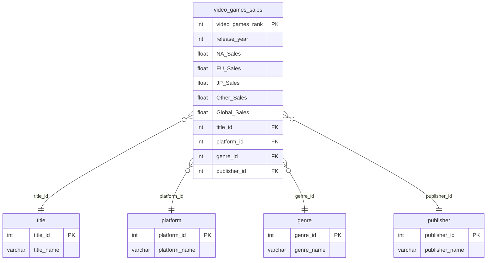

# Video Game Sales: SQL Analysis

Normalizing a flat video-game sales file into a 5-table MySQL database, then answering six business questions for a hypothetical investor with joins, aggregation, `HAVING`, and `COUNT(DISTINCT)`.

*SI 564 (Database Design), University of Michigan School of Information*

**Skills shown:** relational schema design, normalization, ERD, primary/foreign keys, multi-table joins, `GROUP BY` / `HAVING`, turning business questions into queries.

## The scenario

An investor group is considering entering the video-game market and wants to understand the industry's history before presenting to its board. The six questions: top publisher by sales, best average sales per game, each leader's strongest genre, the most open genre for new publishers, the best-selling genre in Europe, and Europe-first hit games.

## Database design

The original data was one flat CSV in which values like `Nintendo` and `Action` repeat thousands of times. I split it into four lookup tables (`genre`, `platform`, `publisher`, `title`) and one fact table (`video_games_sales`) that references them by ID.



A separate `title` table lets one game (e.g. *Grand Theft Auto V*) appear on several platforms while still being counted as one game. Full reasoning: [docs/SI_564_Database_Decisions.pdf](docs/SI_564_Database_Decisions.pdf). Project slides: [docs/SI_564_Presentation.pdf](docs/SI_564_Presentation.pdf).

**Data:** 988 top-selling releases across 24 platforms, 12 genres, 54 publishers and 817 titles. Sales are in millions of units. Source: the public [Video Game Sales dataset on Kaggle](https://www.kaggle.com/datasets/gregorut/videogamesales).

## Findings

| # | Question | Answer |
|---|----------|--------|
| 1 | Top publisher by global sales | **Nintendo**, 1,507.96M (next: Electronic Arts 467.87M) |
| 2 | Best average sales per game (publishers with 30+ games) | **Take-Two Interactive**, 7.52M per game across 34 games; Activision 7.47M, Nintendo 7.11M |
| 3 | Strongest genre of those two | Nintendo: **Platform** (382.08M). Take-Two: **Action** (176.26M) |
| 4 | Genre with the most distinct publishers | **Action**, 29 publishers (Misc 19, Sports 17) |
| 5 | Best-selling genre in Europe | **Action**, 254.68M, then Sports 185.42M |
| 6 | Sold more in EU than NA, and over 10M globally | 12 games, led by *Nintendogs* (24.76M), *Brain Age*, *FIFA 15* |

Nintendo wins on volume, but Take-Two and Activision earn more per game, so scale and per-title strength are different strengths. Action is both the biggest European genre and the most crowded one. Europe-first hits are dominated by football (FIFA) and casual Nintendo titles.

## Queries

### Q1. Publisher with the highest total global sales

```sql
SELECT p.publisher_name, SUM(v.Global_Sales) AS global_total_sales
FROM video_games_sales v
JOIN publisher p ON v.publisher_id = p.publisher_id
GROUP BY p.publisher_name
ORDER BY global_total_sales DESC
LIMIT 5;
```

| publisher_name | global_total_sales |
|---|---|
| Nintendo | 1507.96 |
| Electronic Arts | 467.87 |
| Activision | 373.64 |
| Sony Computer Entertainment | 356.75 |
| Take-Two Interactive | 255.84 |

### Q2. Highest average sales per game (publishers with at least 30 games)

A game released on several platforms counts once, so the count is `COUNT(DISTINCT title_id)`.

```sql
SELECT p.publisher_name,
       SUM(v.Global_Sales) / COUNT(DISTINCT v.title_id) AS avg_sales
FROM video_games_sales v
JOIN publisher p ON v.publisher_id = p.publisher_id
GROUP BY p.publisher_name
HAVING COUNT(DISTINCT v.title_id) >= 30
ORDER BY avg_sales DESC
LIMIT 5;
```

| publisher_name | avg_sales |
|---|---|
| Take-Two Interactive | 7.52 |
| Activision | 7.47 |
| Nintendo | 7.11 |
| Microsoft Game Studios | 5.21 |
| Ubisoft | 4.98 |

### Q3. Strongest genres of the Q1 and Q2 winners

```sql
SELECT g.genre_name, SUM(v.Global_Sales) AS global_total_sales
FROM video_games_sales v
JOIN publisher p ON v.publisher_id = p.publisher_id
JOIN genre g ON v.genre_id = g.genre_id
WHERE p.publisher_name = 'Nintendo'   -- rerun with 'Take-Two Interactive'
GROUP BY g.genre_name
ORDER BY global_total_sales DESC
LIMIT 3;
```

| Nintendo | sales | Take-Two Interactive | sales |
|---|---|---|---|
| Platform | 382.08 | Action | 176.26 |
| Role-Playing | 240.04 | Shooter | 26.94 |
| Sports | 191.49 | Sports | 23.28 |

### Q4. Genre with the most distinct publishers

```sql
SELECT g.genre_name, COUNT(DISTINCT v.publisher_id) AS publisher_count
FROM video_games_sales v
JOIN genre g ON v.genre_id = g.genre_id
GROUP BY g.genre_name
ORDER BY publisher_count DESC
LIMIT 5;
```

| genre_name | publisher_count |
|---|---|
| Action | 29 |
| Misc | 19 |
| Sports | 17 |
| Role-Playing | 17 |
| Shooter | 15 |

### Q5. Best-selling genres in Europe

```sql
SELECT g.genre_name, SUM(v.EU_Sales) AS eu_sales_total
FROM video_games_sales v
JOIN genre g ON v.genre_id = g.genre_id
GROUP BY g.genre_name
ORDER BY eu_sales_total DESC
LIMIT 5;
```

| genre_name | eu_sales_total |
|---|---|
| Action | 254.68 |
| Sports | 185.42 |
| Shooter | 179.46 |
| Platform | 127.19 |
| Role-Playing | 117.70 |

### Q6. Sold more in Europe than North America, and over 10M globally

```sql
SELECT t.title_name, p.publisher_name,
       ROUND(SUM(v.EU_Sales), 2)     AS total_eu_sales,
       ROUND(SUM(v.NA_Sales), 2)     AS total_na_sales,
       ROUND(SUM(v.Global_Sales), 2) AS total_global_sales,
       g.genre_name
FROM video_games_sales v
JOIN title t     ON v.title_id = t.title_id
JOIN publisher p ON v.publisher_id = p.publisher_id
JOIN genre g     ON v.genre_id = g.genre_id
GROUP BY t.title_name, p.publisher_name, g.genre_name
HAVING SUM(v.EU_Sales) > SUM(v.NA_Sales)
   AND SUM(v.Global_Sales) > 10
ORDER BY total_global_sales DESC;
```

| title_name | publisher | EU | NA | Global | genre |
|---|---|---|---|---|---|
| Nintendogs | Nintendo | 11.00 | 9.07 | 24.76 | Simulation |
| Brain Age: Train Your Brain in Minutes a Day | Nintendo | 9.26 | 4.75 | 20.22 | Misc |
| FIFA 15 | Electronic Arts | 10.86 | 2.74 | 16.67 | Sports |
| Brain Age 2: More Training in Minutes a Day | Nintendo | 5.36 | 3.44 | 15.30 | Puzzle |
| FIFA 16 | Electronic Arts | 10.15 | 2.39 | 14.57 | Sports |
| FIFA 14 | Electronic Arts | 9.10 | 2.31 | 14.11 | Sports |
| FIFA Soccer 13 | Electronic Arts | 8.53 | 2.14 | 13.42 | Action |
| Mario & Sonic at the Olympic Games | Sega | 6.38 | 4.22 | 13.20 | Sports |
| The Sims 3 | Electronic Arts | 8.25 | 2.98 | 12.50 | Simulation |
| Animal Crossing: Wild World | Nintendo | 3.52 | 2.55 | 12.27 | Simulation |
| FIFA 12 | Electronic Arts | 7.11 | 1.68 | 10.88 | Sports |
| Gran Turismo 5 | Sony Computer Entertainment | 4.88 | 2.96 | 10.77 | Racing |

## Run it yourself

Import [video_games_sales.sql](video_games_sales.sql) into MySQL 8 (it creates all five tables and loads the data), then run the queries above:

```bash
mysql -u <user> -p -e "CREATE DATABASE video_games_sales"
mysql -u <user> -p video_games_sales < video_games_sales.sql
```
